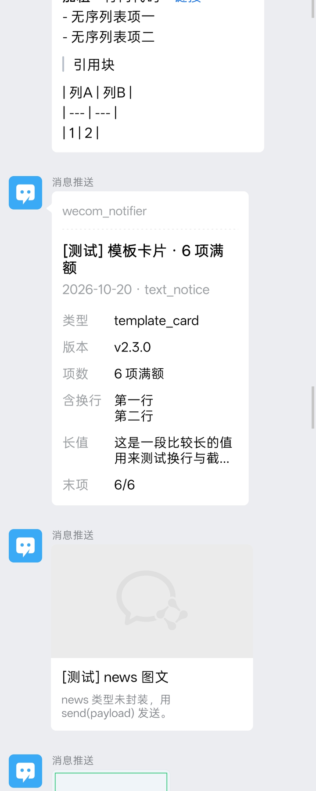
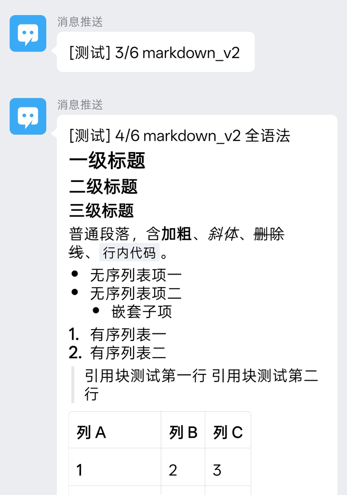
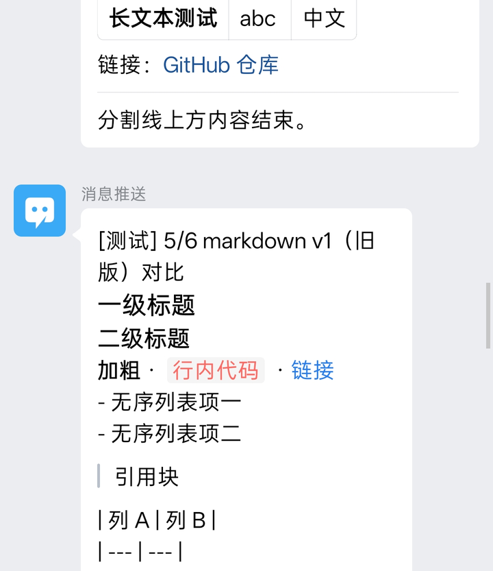
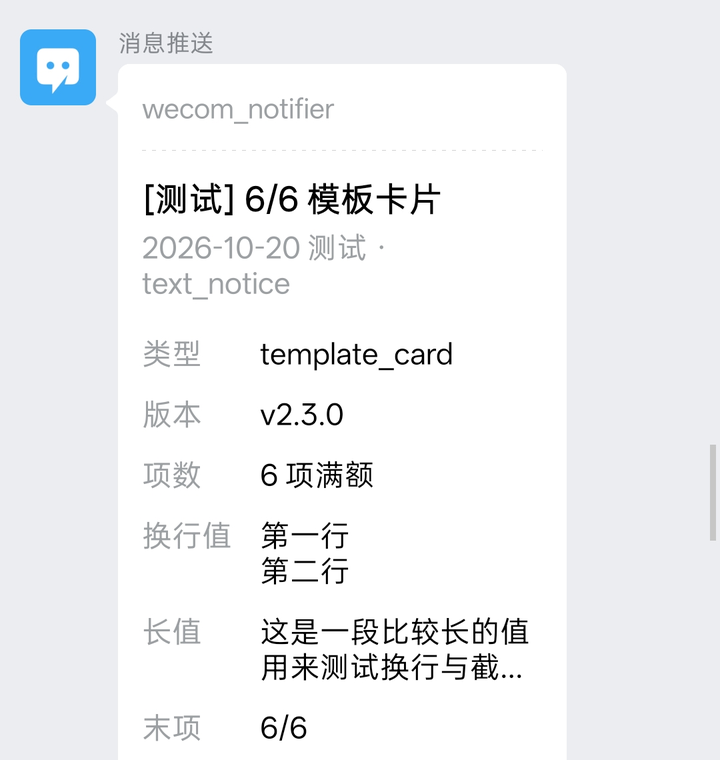
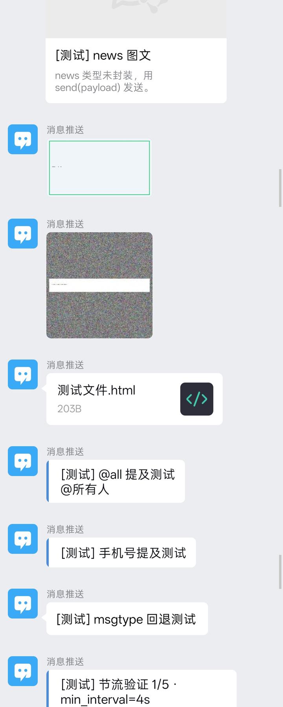
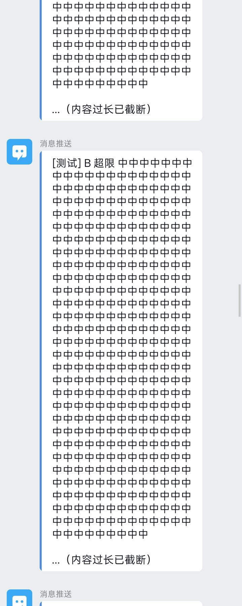

# wecom_notifier

企业微信群机器人（webhook）推送工具。**一个文件，零强制依赖**，覆盖文本 / 富文本 / 模板卡片 / 图片 / 群文件五类消息，命令行和 Python API 双入口。

- Python 3.8+ 标准库即可运行；`requests`、`Pillow` 可选增强
- 适用：告警通知、日报播报、运维提醒、报表与图片分发、青龙面板定时任务


```bash
python wecom_notifier.py text "Hello 企业微信"
```

---

## 目录

| 章节 | 内容 |
| --- | --- |
| [1. 三步上手](#1-三步上手) | 拿到 key，发出第一条消息 |
| [2. key 与配置](#2-key-与配置) | 五种来源的优先级、其它环境变量 |
| [3. 命令行](#3-命令行) | 五类消息的用法与参数 |
| [4. Python 调用](#4-python-调用) | 类方法、模块函数、返回值与重试 |
| [5. 限制与实测表现](#5-限制与实测表现) | 体积上限、限频、**真机截图**、v2.2.0 升级差异 |
| [6. 签名校验](#6-签名校验可选) | 机器人开了「签名校验」怎么办 |
| [7. 青龙面板](#7-青龙面板) | 定时任务零配置 |
| [8. 退出码](#8-退出码) | 调度平台如何判断成败 |
| [9. 排查](#9-排查) | 报错对照表 |

---

## 1. 三步上手

```bash
# ① 拿 key：群设置 → 群机器人 → 添加/查看机器人 → Webhook 地址里 ?key= 后面那串
#    https://qyapi.weixin.qq.com/cgi-bin/webhook/send?key=xxxxxxxx-xxxx-...

# ② 配 key（任选其一）
export WECOM_WEBHOOK_KEY="你的-key"              # Linux / macOS
set    WECOM_WEBHOOK_KEY=你的-key                 # Windows CMD
$env:WECOM_WEBHOOK_KEY="你的-key"                 # Windows PowerShell

# ③ 发第一条
python wecom_notifier.py text "Hello 企业微信"

# 不确定配没配对？空跑看请求体，不会真发
python wecom_notifier.py text "测试" --dry-run -v
```

> **key 就是「往这个群发消息」的权限**，别写进公开仓库。
>
> Windows 中文控制台乱码是 GBK 编不出 `✅❌⚠️`：v2.3.0 起会自动降级成纯文本不会崩，想看图标执行
> `$env:PYTHONIOENCODING="utf-8"; chcp 65001`。

---

## 2. key 与配置

五种来源按顺序命中即止：



| 顺序 | 来源 | 说明 |
| --- | --- | --- |
| 1 | `--webhook` | 完整地址，优先级最高 |
| 2 | `--key` | 只传 key，也可直接传完整地址 |
| 3 | `WECOM_WEBHOOK` | 完整地址 |
| 4 | `WECOM_WEBHOOK_KEY` | 只放 key（最常用） |
| 5 | `QYWX_KEY` | 青龙面板通知设置自动生成；与第 4 项同级，`WECOM_WEBHOOK_KEY` 存在时优先用它 |
| — | 全都没配 | 打印配置指引，退出码 2；**没有内置 key** |

另外两个环境变量：

| 变量 | 作用 |
| --- | --- |
| `WECOM_SECRET` | 机器人安全设置里的「加解密密钥」，设了即启用签名校验 |
| `WECOM_TIMEOUT` | 单次请求超时秒数，默认 8.0；填非数字报「配置错误」并退出 2 |

> webhook 域名必须是 `qyapi.weixin.qq.com`，其它域名本地直接拒绝，避免 key 泄漏给第三方。

---

## 3. 命令行

```
python wecom_notifier.py <子命令> [内容/路径] [公共参数]
```

公共参数：

| 参数 | 说明 |
| --- | --- |
| `--key` / `--webhook` | 见 [2. key 与配置](#2-key-与配置)，`--webhook` 优先 |
| `--secret` | 启用签名校验 |
| `--timeout` | 请求超时秒数 |
| `--max-bytes` | markdown 正文字节上限，默认 4096 |
| `--image-max-bytes` | 图片 base64 上限，默认 2MB |
| `--rate SEC` | 两次发送的最小间隔秒数；**批量推送用 `4`**（限频是滚动窗口，详见 [5](#5-限制与实测表现)） |
| `--dry-run` | 只打印请求体，不发送 |
| `-v, --verbose` | 打印目标 webhook（脱敏） |
| `--version` | 打印版本号 |

**内容参数三种写法**：字面文本；`-` 从 stdin 读；`@路径` 从 UTF-8 文件读。
`@` 开头但文件不存在时仍按字面发送，方便直接发 `@all`。

### 3.1 text — 纯文本

```bash
python wecom_notifier.py text "服务器 CPU 95%"
python wecom_notifier.py text "请值班同学处理" --mention zhangsan --mention lisi
python wecom_notifier.py text "紧急" --mention-mobile 13800000000
```

上限 **2048 字节**（企微 text 硬限制），超限自动截断并告警，`--max-bytes` 放大不了。

### 3.2 markdown — 富文本

默认 `markdown_v2`（支持标题、列表、表格、引用）；`--v1` 切旧版（兼容性最好但**不渲染列表和表格**，见 [5.1](#51-markdown_v2-与-v1-的真实差别)）。

```bash
# 真换行：用 printf / $'...' / heredoc，别写 "\n"（那是字面反斜杠加 n）
printf '# 日报\n- 样本 155\n- **耗时** 0.7s' | python wecom_notifier.py markdown -
python wecom_notifier.py markdown $'# 日报\n- **耗时** 0.7s'          # bash / zsh
python wecom_notifier.py markdown @report.md                            # 从文件读（最省事）
```

上限 **4096 字节**，`--max-bytes` 可调。

### 3.3 card — 模板卡片

```bash
python wecom_notifier.py card "扫描完成" \
  --desc "2026-09-05 收盘" \
  --item 样本=155 --item 耗时=0.7s --item 命中=12 \
  --source "板块扫描器" --url "https://gu.qq.com"
```

- `--item` 可重复，**最多 6 项**，超了直接报错（不再静默丢弃）
- 标题不能为空；`--url` 省略时用官方兜底链接
- 只封装了 `text_notice`；`button_interaction` / `news_notice` 字段结构不同，用 `bot.send(payload)` 自己构造

### 3.4 image — 图片

```bash
python wecom_notifier.py image ./chart.png
python wecom_notifier.py image a.png b.jpg --rate 4      # 多图批量，自动限速
python wecom_notifier.py image big.png --no-compress     # 超限直接报错，不压缩
```

- 类型按**文件头魔数**判定，扩展名是 `.png` 实际是 webp 的会在本地拦下
- 超过 2MB 自动降质 + 缩放（需 `pip install pillow`）；PNG 降不动会自动转 JPEG 再压

### 3.5 file — 群文件

```bash
python wecom_notifier.py file ./report.html
python wecom_notifier.py file ./data.xlsx --name "2026-09-05 数据.xlsx"
```

体积 5B ~ 20MB，读取前先用文件属性判定大小，不会为了量体积把 20MB 读进内存。
**群里显示成文件卡片，点开是下载不是预览**——详见 [5.3](#53-图片与群文件的真实表现)。

---

## 4. Python 调用

### 4.1 客户端类

```python
from wecom_notifier import WeComBot

bot = WeComBot(key="你的-key")          # 省略 key 则读环境变量
result = bot.send_markdown("# 标题\n- **加粗**")

if result:                              # SendResult 可直接当 bool
    print("发送成功")
else:
    print("失败", result.errcode, result.errmsg, "可重试:", result.retryable)
```

| 方法 | 说明 |
| --- | --- |
| `send_text(content, mentioned_list=None, mentioned_mobile_list=None)` | 纯文本，可 @人 |
| `send_markdown(content, msgtype=None)` | 富文本，`msgtype` 取 `markdown_v2` / `markdown` |
| `send_template_card(title, desc, items, source_desc, url, card_type="text_notice")` | 卡片，`items=[(k, v), ...]`，最多 6 项 |
| `send_image(path)` | 本地图片，自动压缩；也可传 `base64_data` + `md5` |
| `send_file(local_path, filename=None)` | 群文件 |
| `send(payload)` | 任意合法 payload（news 等未封装类型） |

以上方法都带 `dry_run=False`，置 True 只打印请求体（图片连压缩都跳过）。

构造参数：`key` / `webhook` / `secret` / `timeout=8.0` / `min_interval=0.0` / `max_bytes=4096` / `image_max_bytes=2MB`。
`min_interval` 是两次发送的最小间隔，批量推送设 `4.0` 可自动规避限频。

### 4.2 模块级函数

一行调用，返回 `(ok, err)`：

```python
from wecom_notifier import send_text, send_markdown, send_image, send_file

ok, err = send_markdown("# 日报")
ok, err = send_image("./chart.png", key="你的-key")
if not ok:
    print("推送失败:", err)
```

### 4.3 返回值与重试


**任何发送阶段的错误都不抛异常**：网络异常、接口报错、参数不合法（文件不存在、格式不支持、超限、卡片超 6 项、payload 缺 msgtype）一律返回失败的 `SendResult`。
`WeComError` 只在**构造 `WeComBot`** 时抛（key 缺失、域名不符、超时非数字）。

| 字段 | 含义 |
| --- | --- |
| `ok` / `bool(result)` | 是否成功 |
| `errcode` / `errmsg` | 企微返回码与文案；`errmsg` 已附排查链接 |
| `retryable` | 值得重试：网络异常、45009 限频、HTTP 5xx |
| `status` | HTTP 状态码，有响应时才有值 |

```python
import time

for attempt in range(3):
    result = bot.send_text("巡检完成")
    if result or not result.retryable:
        break
    time.sleep(2 ** attempt)
```

---

## 5. 限制与实测表现


| 类型 | 上限 | 格式 | 备注 |
| --- | --- | --- | --- |
| text | 2048 字节 | 纯文本 | 超限自动截断 |
| markdown / v2 | 4096 字节 | markdown | `--max-bytes` 可调 |
| template_card | — | key-value ≤ 6 项 | 标题必填 |
| image | base64 ≤ 2MB | 仅 JPEG / PNG（按魔数判定） | 超限自动压缩，需 Pillow |
| file | 5B ~ 20MB | 任意 | 不内联预览 |

**限频：滚动 60 秒窗口内最多 20 条，且同一 key 的所有进程共享这个窗口。**
不是「每分钟清零一次」——实测未节流连发 22 条，第 1–13 条成功、第 14–22 条全部 `45009`，
因为前一轮已经把窗口额度吃掉一半。所以别按 20 条卡点，用 `--rate 4` 留 30% 余量。

<figure>
  
  <figcaption>实测：连续推送时卡片 / news / 图片 / 文件的排列。图片和文件要先上传，比 text 慢，批量时会「迟到」，不是乱序 bug。</figcaption>
</figure>

以下结论全部来自**企业微信 Android 客户端真机截图核对**，不是照抄官方文档。

### 5.1 markdown_v2 与 v1 的真实差别

同一份内容，左 `markdown_v2`、右 `markdown`：

<p align="center">
  
  
</p>

看右图底部：`| 列A | 列B |` 和 `| --- | --- |` 被原样打印，`- 无序列表项一` 只是个带短横线的普通段落。

| 语法 | v2 | v1 |
| --- | --- | --- |
| `#` `##` `###` 标题 | ✅ 字号递减 | ✅ |
| `**加粗**` `*斜体*` `~~删除~~` `` `代码` `` | ✅ | ✅ |
| `-` 无序 / 嵌套 | ✅ 圆点 + 正确缩进 | ⚠️ 原样输出 `- 项` |
| `1.` 有序 | ✅ 自动编号 | ⚠️ 原样输出 `1. ` |
| `>` 引用 | ✅ 竖线 + 灰底（多行合并成一段） | ⚠️ 只有竖线 |
| `\| 表格 \|` | ✅ 真表格，表头灰底、列宽自适应 | ❌ 原样输出竖线文本 |
| `[文字](url)` `---` | ✅ | ✅ |

**结论：内容里有表格或列表就必须用 `markdown_v2`。** v1 只适合「只需要标题和换行」的场合。

### 5.2 模板卡片



- `desc` 和 `items` 的 `\n` **都能正常换行**（上图「含换行」项占两行）
- **单个 value 超长会被省略号截断**（「长值」项），换行后最多约两行——所以长 URL 别塞 key-value，放 `card_action.url`
- `source.desc` 显示在卡片顶部，灰色小字，适合放服务名
- 卡片是独立样式，没有 text / markdown 那条头像蓝条，视觉更醒目

### 5.3 图片与群文件的真实表现



- **图片**：大图在群里被压成小缩略图（实测 2400×1350 PNG 显示只有约 200px 宽，里面文字糊掉），点开才是原尺寸。
  自动压缩确实在工作（6.7MB 噪声 PNG 走 PNG → JPEG 回退后成功送达），但**视觉损失明显**——
  要保真就自己先压到 2MB base64 以内，别依赖自动压缩。
- **群文件**：显示成「图标 + 文件名 + 大小」的卡片，**点开是下载，不是内置浏览器预览**。
  想让 HTML 直接可看，只能用 markdown 里的链接指向一个可访问的 URL。
- **news**：`send(payload)` 发出去就是图文卡片，`picurl` 为空时顶部是灰色占位图，不影响标题和描述。
  能不用就不用，markdown 和 template_card 更省事。
- **@人**：`mentioned_list=["@all"]` 显示为「@所有人」。

### 5.4 超长截断



截断的 text 会以 `…（内容过长已截断）` 收尾，群里看得见。
`_truncate` 优先在换行处收尾，避免把 markdown 结构切一半；纯中文长段落没有换行时只能硬切，可能出现半个词。
需要结构化截断就自己 `content[:n] + "……"` 再发。

### 5.5 从 v2.2.0 升级

| 项 | v2.2.0 | v2.3.0 |
| --- | --- | --- |
| 签名 timestamp | 构造时算一次，长驻进程会过期 | 每次请求前现算 |
| text 长度 | 与 markdown 共用 4096 | 独立收口 2048 |
| 超长截断 | 静默 | 告警 + 尽量在换行处收尾 |
| 卡片超 6 项 | 静默丢弃 | 直接报错 |
| 图片 dry-run | 仍做完整压缩 | 只校验类型 |
| PNG 大图 | 只缩放不降质 | 降不动转 JPEG 重试 |
| `WECOM_TIMEOUT` 非法 | 裸抛 ValueError | 「配置错误」退出码 2 |
| Windows GBK 控制台 | emoji 崩溃 | 自动降级纯文本 |

完整改动见 [CHANGELOG.md](CHANGELOG.md)。

---

## 6. 签名校验（可选）

机器人安全设置开了「签名校验」才需要：

```bash
python wecom_notifier.py text "带签名的消息" --secret "你的-加解密密钥"
```

```python
bot = WeComBot(key="...", secret="...")
```

每次请求前重算 `timestamp` 与 `msg_signature`（`Base64(HMAC-SHA256(secret, timestamp + "\n" + secret))`）。
签名对时间敏感，长驻进程请**复用同一个 `WeComBot` 实例**。
未开启签名校验的机器人不要传 `--secret`，会报错。

---

## 7. 青龙面板

1. `wecom_notifier.py` 放进 scripts 目录（如 `/ql/data/scripts/`）
2. 依赖（可选）：面板「依赖管理 → Python3」加 `requests`（发大图再加 `pillow`），或容器内 `pip3 install requests pillow`
3. 「系统设置 → 通知设置 → 企业微信机器人」填 key，青龙存成 `QYWX_KEY`，**脚本自动读取，不用再传 key**
4. 新建任务：

```bash
python3 /ql/data/scripts/wecom_notifier.py text "定时任务执行完毕"
python3 /ql/data/scripts/wecom_notifier.py markdown @/ql/data/scripts/report.md
python3 /ql/data/scripts/wecom_notifier.py image /ql/data/repo/chart.png --rate 4
```

---

## 8. 退出码

| 码 | 含义 |
| --- | --- |
| 0 | 全部成功 |
| 1 | 有一条或多条失败 |
| 2 | 配置或输入错误（缺 key、域名不符、超时非数字、文件读失败、卡片参数非法等） |

---

## 9. 排查

| 现象 | 原因 | 处理 |
| --- | --- | --- |
| `93000 invalid webhook url` | key 填错/失效，或机器人被移除 | 核对 Webhook 里的 key |
| `45009 api freq out of limit` | 滚动 60 秒窗口超 20 条 | 加 `--rate 4`；额度跨进程共享 |
| `40058 请求参数不合法` | 正文超长或 msgtype 不支持 | 确认长度；text 上限 2048B |
| 「域名不是企微官方域名」 | 传了第三方 URL | 只用 `qyapi.weixin.qq.com` |
| 「未配置企业微信 webhook key」 | 环境变量没生效 | 确认已 export/set，青龙用 `QYWX_KEY` |
| 「WECOM_TIMEOUT 不是合法数字」 | 填了非数字 | 改成秒数如 `8`，或删掉 |
| 「文件内容不是有效 JPEG/PNG」 | 实际是 webp/gif 或扩展名造假 | 先转成真正的 JPG/PNG |
| 「未安装 Pillow 无法自动压缩」 | 大图超 2MB | `pip install pillow`，或先自己压 |
| 群文件「低于 5B / 超过 20MB」 | 体积不合规 | 压缩或分包 |
| 卡片「最多 6 项」 | `--item` 传多了 | 精简或拆卡 |
| 群里看到 `- 项`、表格变成竖线 | 用了 v1，它不渲染列表表格 | 换 `markdown_v2` |
| 卡片里 URL 点不了 | value 超长被截断 | URL 放 `card_action.url` |
| HTML 群文件想直接看 | 群文件只下载不预览 | 用 markdown 链接指向可访问 URL |
| 图片很糊 | 客户端缩略图 + 自动压缩双损失 | 自己先压到 2MB 以内 |
| 其它 errcode | — | `errmsg` 已附 `open.work.weixin.qq.com/devtool/query?e=<errcode>` |

调试三板斧：

```bash
python wecom_notifier.py text "测试" --dry-run -v    # ① 看请求体与目标地址，不发
python wecom_notifier.py text "测试" -v              # ② 真发并看脱敏地址
python wecom_notifier.py text "测试" --timeout 20    # ③ 网络慢时延长超时
```

---

## 10. 可选依赖与安全

| 包 | 缺失时 | 安装 |
| --- | --- | --- |
| `requests` | 回退标准库 `urllib`，功能不受影响 | `pip install requests`（线程内 Session，连接池复用） |
| `Pillow` | 图片超 2MB 无法自动压缩，报错 | `pip install pillow` |

- key 走环境变量或参数，别硬编码进脚本、别提交到仓库
- 日志里的 webhook 已脱敏（只留 key 前 6 位）；`--dry-run` 打印的图片 base64 已替换成体积占位符，可以放心贴群
- 域名白名单：只有 `qyapi.weixin.qq.com` 会被接受

---

<sub>矢量配图在 `docs/*.svg`，用 `pwsh docs/build_diagrams.ps1` 重新生成，GitHub 上随深浅色主题自动切换；真机截图在 `docs/img/`。</sub>
